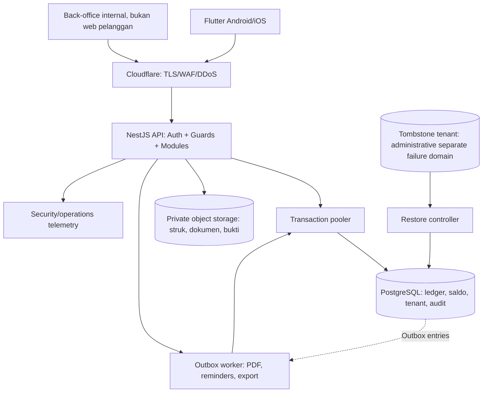

# SOFTWARE ARCHITECTURE DOCUMENT — SAD V1.0
## SaaS Penjualan Pupuk, Pestisida, dan Alat Pertanian | FREE Trial + PRO

**Status:** ARSITEKTUR A DISETUJUI PEMILIK; **SAD V1.0 — RANCANGAN TEKNIS UNTUK REVIEW/IMPLEMENTASI BERTAHAP**. Bukan sertifikat keamanan atau izin rilis.
**Tanggal:** 8 November 2026
**Sumber normatif produk:** `PRD_V1_1_FINAL.md` (FINAL/disahkan) dan `DRAFT_V4_10_LANDASAN_PRD_PENJUALAN_PERTANIAN.md` sebagai riwayat keputusan. **Bukti teknis awal:** PoC Arsitektur A R3, bukan kode produksi dan bukan bukti seluruh risiko tertutup.
**Keputusan baru pemilik:** arsitektur A resmi; repository privat GitHub dan GitHub Actions resmi untuk tahap pengujian. **Belum diputus:** penyedia cloud produksi, provider identitas/OTP, domain, lokasi setiap subprosesor, kebijakan RPO/RTO, harga cloud, jalur billing berlangganan, rentang versi framework/OS yang akan didukung.

> Urutan wewenang: (1) PRD V1.1 FINAL mengatur perilaku, (2) keputusan arsitektur A mengatur kelas teknologi, (3) SAD ini mengatur cara mengimplementasikan, (4) ADR mencatat trade-off. SAD **tidak** boleh mengubah masa trial, paket, rumus uang, hak Admin, atau gerbang C-01–C-04. Bila ada ketidakmungkinan teknis memenuhi kalimat PRD secara literal, buka technical blocker + permintaan keputusan, **jangan redefinisi diam-diam**.

## 1. Executive architecture decision

| Lapisan | Pilihan desain | Status |
|---|---|---|
| Android/iPhone | Flutter/Dart, satu codebase, adaptif untuk HP/tablet | Ditetapkan arsitektur |
| Backend API | NestJS/TypeScript di Node LTS yang dipin, **modular monolith** | Ditetapkan arsitektur; versi runtime dipin di tahap implementasi |
| Database OLTP | PostgreSQL terkelola, satu sumber kebenaran untuk saldo/ledger, ACID | Ditetapkan arsitektur; provider/region dan tier menunggu keputusan |
| Koneksi DB | PgBouncer transaction pooling atau pooler setara; tidak menggunakan session-GUC permanen | Ditetapkan prinsip |
| Edge | Cloudflare TLS + WAF/rate-limit tepi sebagai pertahanan tambahan | Ditetapkan prinsip; paket/vendor konfigurasi belum final |
| File privat | Object storage privat, metadata/ACL di PostgreSQL, akses melalui API atau signed URL pendek | Pola; produk/region belum dipilih |
| Jobs | Outbox transaksional + worker idempoten; tidak memasukkan uang/stok kritis ke queue eventual | Pola |
| Audit/telemetry | Structured logs terpisah dari ledger, redaksi PII/secret, audit append-only | Pola |
| Pengujian | GitHub private repo + GitHub Actions + PostgreSQL/PgBouncer container sementara | Keputusan pemilik |
| Staging/production | Lingkungan, akun, key dan DB terpisah; provider produksi TBD | Belum dipilih |

**Bukan microservices** pada FREE/PRO; setiap transaksi uang/stok dapat memakai satu transaksi PostgreSQL tanpa distributed transaction. Layanan autentikasi, penagihan SaaS, kios, dan back-office dipisah per modul dan batas izin meskipun satu deployment awal. Memecah layanan di masa depan perlu ADR baru dan pengujian ulang konsistensi.

### 1.1 Diagram data-flow

Tidak ada panah klien→DB. **Kasir tidak menggunakan service key, kredensial cloud atau DB.** Penjualan final tidak bergantung pada respons printer/PDF atau pekerjaan queue.

## 2. Bounded contexts dan batas transaksi

| Modul NestJS | Tugas | Menulis | PRD |
|---|---|---|---|
| Identity / Sessions | OTP, sandi, pemulihan, sesi, reauth, revoke, actor identity | account, session, auth_audit | AUTH-01..07 |
| Tenant / Subscription | trial 7×24h, plan, entitlement, grace, lock, offboarding | subscription, entitlement_event, tenant | ENT-01..10 |
| Catalog / Pricing | SKU, varian, kemasan berversi, harga, usulan Admin/approval Owner, kuota promo | product, package_version, price_rule, promotion | PRD-01..08; POS-03..05 |
| Inventory | receiving, stock opening, hold, FEFO, stock count, transfer status, inventory ledger | stock_balance, inventory_ledger, cost_pool | INV-01..11 |
| Cost | moving average, HPP snapshots, resale status, valuation corrections | cost_pool, value_ledger, cost snapshots | COST-01..07 |
| Checkout / POS | preview vs **atomic finalization**, sale lines, tax snapshots, document sequence | sale, sale_line, payment, inventory events | POS-01..08 |
| Receivables | payment allocation, due date, settling old invoices | invoice_balance, payment_alloc | PAY-01..09 |
| Returns / Refunds | Owner approval, return, correction, pending/refund paid/returned, cash | return, correction, refund_*, cash_ledger | RET-01..12 |
| Payment Exceptions | `RECEIVED_UNMATCHED`, allocation in-session or refund, carry-over | unmatched_receipt, exception_* | EXC-01..09 |
| Cash Day | cash physical vs expected, closing, carry-over authorisation | cash_day, cash_movement | CASH-01..07 |
| Subsidized Fertilizer | allocation numbers, physical stock, HET version, internal distribution | subsidized_* | SUB-01..09 |
| VAT | Owner switch/rate/coverage, snapshot, deterministic half-up and remainders | vat_setting_version, line tax snapshots | VAT-01..10 |
| Document / Reporting | PDF, print duplicate tag, CSV export, reports | document_meta, export_job | DOC-01..; ANL-* |
| Platform Console | SaaS invoice/entitlements, support grant, security incident | platform_audit, subscription_invoice | PLAT-* |

**Boundary:** Seller sale+stock+HPP+invoice+payments+VAT+promotion quota+idempotency + outbox metadata = **satu DB transaction**. Refund approval/payment+invoice balance+cash movement+idempotency = **satu DB transaction**. Karton→lepas+inventory ledger+cost reallocation = **satu DB transaction**. Transfer manual di bank adalah tindakan eksternal yang **tidak** dapat dimasukkan ke transaksi ACID DB; rekonsiliasi harus eksplisit (C-03).

## 3. Runtime deployment, consistency, concurrency

- API stateless kecuali sesi yang disimpan server; beberapa instance dapat menerima request dengan satu sumber entitlements dan saldo.
- Semua transaksi operasi sensitif menggunakan `BEGIN`/`COMMIT` pada **satu koneksi yang dipin selama transaksi**; PgBouncer dalam `transaction` mode. Tidak ada penggunaan session-level `SET` yang hidup di luar transaksi.
- Request `GET` yang menentukan checkout tidak boleh dipercaya tanpa pemeriksaan ulang pada `POST /sales`. Tidak ada cache read-through yang dijadikan otoritas stok/harga pada jalur commit.
- Gunakan `UNIQUE` untuk kunci bisnis dan idempotensi; FK komposit `(tenant_id, object_id)` pada semua hubungan child→parent; `CHECK` hanya untuk nilai satu baris. Invarian lintas tabel diverifikasi dalam prosedur transaksi dengan lock/invariant projection.
- `READ COMMITTED` + row lock terurut dipakai sebagai kandidat default (bukan konsensus final seluruh fungsi); isolasi `SERIALIZABLE` untuk fungsi yang menunjukkan anomali tulis-baca setelah uji. Retry hanya untuk `40001`/`40P01`, dengan batas, backoff dan idempotency; validasi kewenangan/expiry diulang pada setiap retry.
- Urutan lock global: tenant entitlement → objek campaign/promo → produk/varian/batch (urut ID) → cost pool → invoice/exception → refund account → cash day; koreksi spesifik jika dibutuhkan ADR dan stress-test. Operasi stock hold harus berkoordinasi dengan checkout lewat lock dimensi yang sama; prioritas keselamatan blokir baru segera setelah commit hold.
- Outbox `event_id` hanya menyampaikan kerja non-kritis; worker at-least-once, dedup `event_id`, retry DLQ, data anonim minimum; tidak membuat uang/stok dari event asinkron.
- Harga/tarif PPn/HET memakai effective-dated snapshot yang konsisten dalam transaksi. Admin PRO mengajukan harga/grosir/promo; hanya approval Owner yang mempublikasikan nilai efektif.
- Akuntansi: `bigint` rupiah dan qty integer; saat mengalikan nilai dan jumlah gunakan `numeric` PostgreSQL / bigint aman, tidak gunakan float JavaScript untuk uang. JSON API memaparkan integer yang aman atau string desimal rupiah (keputusan representasi API: **string rupiah** untuk mencegah hilangnya presisi >2^53-1 di JS).

### 3.1 Trial deadline — HARD technical gate (R3/AS-11)

PRD ENT-01/04 dan ST-SUB-02 memakai **waktu commit** sebagai syarat final. R3 memakai deferred constraint trigger; `SET CONSTRAINTS ... IMMEDIATE` dapat memajukan eksekusinya, dan waktu eksekusi trigger terjadi **sebelum** pencatatan commit tahan-gagal selesai. Mengganti dengan `now()`/`transaction_timestamp()` lebih buruk karena membekukan waktu pada awal transaksi.

**Desain mitigasi kini (bukan klaim kesetaraan formal):**
1. Backend menyelesaikan seluruh kalkulasi, lock, dan validasi di DB; pengecekan terakhir memakai `clock_timestamp()` saat tepat sebelum `COMMIT`, dengan batas keselamatan konservatif dan timeout request/statement.
2. Jangan membuka SQL endpoint bagi klien. Cabut hak DML/DDL langsung dari `app_runtime`, larang operator transaksi menjalankan `SET CONSTRAINTS`; jangan bergantung pada larangan di aplikasi saja karena SQL injection dapat mengubah perilaku.
3. Transaksi mendekati batas TTL harus **ditolak secara konservatif** bila tidak ada waktu aman untuk commit, tanpa mengurangi stok/uang. Idempotency key mengembalikan outcome komit atau status pending inquiry, tidak berasumsi gagal saat jaringan putus.
4. Di CI uji T-06a/b/c: transaksi tertahan kunci sampai expiry; `SET CONSTRAINTS ... IMMEDIATE` yang dipaksa di lab; fault injection commit delay di sekitar cutoff, kemudian ambil status dan waktu commit teramati.
5. Validasi bersama tim DBA bahwa mekanisme commit-literal PRD dipenuhi pada PostgreSQL terkelola pilihan. **Tidak ada jaminan teoretis dari trigger biasa bahwa timestamp commit tidak melewati expiry.** Jika pengujian/arsitektur tidak dapat membuktikannya, buat *architecture exception/PRD change request* untuk diputus Owner; **SAD tidak mengubah arti PRD secara diam-diam**.

**Status:** sebagian mitigasi dirancang, **T-06c dan bukti literal commit belum lulus**. Ini gate sebelum penjualan pada layanan nyata; SAD dapat dikaji lebih lanjut dengan risiko tercatat, tetapi tidak boleh diklaim ditutup definitif.

### 3.2 R3 technical debt closure status

| Audit/R3 issue | Desain SAD | Bukti wajib |
|---|---|---|
| R2-01 tenant impersonation | Identity terverifikasi melalui sesi server + lookup opaque session secret di `iam`, role aplikasi tak punya akses `iam`, tenant SQL tidak dipercaya dari request | forged tenant, forged token, anon, revoked token, replay, SQL injection; T-05/API-01/02/X-06/N-08 |
| R2-02 commit trial | Guard sangat akhir + konservatif + uji commit timing; tidak klaim penutupan mutlak | T-06a/b/c + timed fault injection |
| R2-03 silent migration failure | `psql -v ON_ERROR_STOP=1`, shell `set -Eeuo pipefail`, migrasi satu transaksi bila DDL mendukung | fixture broken migration harus membuat CI FAIL |
| R1-01 direct DML | app_runtime tanpa direct write, penulisan hanya fungsi/repositori server yang disahkan | negative GRANT checks, permission denied |
| R1-02 cross-tenant FK | FK `(tenant_id,id)`, unique `(tenant_id,id)`, full row RLS | 403/404 no leak, FK negative |
| R1-04 carton disappearing units | upsert stok `LOOSE` status/batch, verifikasi affected rows dan unit + value invariant atomik | open carton absent LOOSE |
| R1-05 reused idem with different payload | canonical payload hash + uniqueness per tenant + endpoint/scope; mismatch HTTP 409 | same key/same body replay ID; changed body 409 |
| Role read/Owner-only | Reader tidak otomatis bisa melihat seluruh kolom hanya karena satu tenant; service policy + limited views/role checks | Admin export/personal/secret forbidden |
| Incident restore tenant resurrection | tombstone di *separate failure domain*, restore isolate + re-delete + reconcile + unblock | T-08, Cloud managed PITR drill |

## 4. Database & API design — authoritative attachments

`DATABASE_DESIGN_V1_0.md` mengatur tabel, relasi, partisi/indeks, role, RLS, audit, append-only dan jalur posting. `API_CONTRACT_V1_0.md` mengatur endpoint, header identitas, status HTTP, JSON, idempotensi dan alur error. Perbedaan antara kedua dokumen dan PRD → PRD menang, dicatat sebagai defect dalam issue GitHub.

## 5. Identity/tenant & role enforcement

- HP/OTP (sekali aktivasi trial) + sandi login rutin; OTP hash, masa berlaku dan rate limit masih parameter keamanan sebelum produksi, tidak dikarang. Reauth Owner memakai *fresh auth evidence* terikat tindakan+objek+nominal, sekali pakai.
- Session token high-entropy server-side (mis. 256-bit CSPRNG sebagai pilihan desain), hanya hash disimpan, rotasi dan revoke server-side. Mobile menyimpan token di Keychain/Android Keystore, tidak di plaintext/shared preferences.
- API menentukan tenant/actor dari token, bukan tenant_id/header/body. DB memverifikasi keterikatan akun–tenant dan revoked/expiry sebelum setiap operasi. Token mentah jangan dicatat di log/trace; bila diteruskan sebagai LOCAL GUC ke Postgres, gunakan sesi database tepercaya, keamanan transport, tidak boleh di log statement, tidak pernah session-scoped; ini kompromi PoC R3 yang perlu review ancaman injeksi.
- Role SQL `migration_owner`, `app_runtime`, `runtime_function_owner`, `offboarding_controller`, `audit_reader`, `support_metadata` (izin minimum). `app_runtime` bukan owner tabel, `NOBYPASSRLS`, tanpa superuser, tidak memiliki `CREATE` di schema tepercaya, tanpa direct DML terhadap tabel ledger. `FORCE ROW LEVEL SECURITY` untuk tenant tables.
- DB `SECURITY DEFINER` ber-search_path fixed (`pg_catalog, app, pg_temp` sebagai usulan; schema terverifikasi dan objects fully-qualified), revoke default EXECUTE `PUBLIC`, allowlist function-specific; fungsi recek role dan tenant, tidak hanya bergantung guard NestJS.
- Owner/Admin akses baca dibedakan di service dan melalui view/restriksi kolom DB jika diperlukan. Operator SaaS hanya metadata langganan, tiket, grant; data retail tidak diakses default. Akses dukungan butuh grant Owner TTL + alasan + audit.
- Pengaturan PPN, HET, subsidi, arsip pelanggan, consent/legal basis harus mematuhi PRD dan C-01/C-02; no NIK/HP for farmer distribution in v1.

## 6. Product workflows & failure semantics

**Checkout:** `Quote` read-only, kemudian `POST /sales` yang mengunci stok, cek batch/expiry/hold/stock, hitung harga termurah berlaku, PPN snapshot, saldo, HPP, receipt+payment, idempotensi; commit serentak; hanya setelah commit request PDF/print. Respons hilang → klien `GET /operations/{key}` sampai status final; tidak mengulangi pembayaran eksternal.

**Bank already received / checkout failed:** bukti receipt eksternal di-verifikasi manusia; `unmatched_receipt` (tanpa Sale) mencatat nilai, referensi dan bukti terotentikasi; Owner pilih alokasi di sesi sama atau refund pending. Ditutup hari hanya jika Owner memutuskan kewajiban; FREE dan PRO sama.

**Invoice refund:** `F+C−R−(P−Rf)`, `Q≤max(-B,0)` atomik; `Rf` neto keluar yang sudah terverifikasi dikurangi dana yang benar-benar kembali. Approval transfer manual `APPROVED_NOT_SENT`→`TRANSFER_MARKED_SENT` (boleh retry attempt di approval sama)→`PAID_VERIFIED`; refund tunai langsung `PAID_CASH`; `REFUND_RETURNED` pembalik *posting efektif* dengan bukti, audit keduanya tetap. Jangan mengirim instruksi transfer bank otomatis.

**Exception refund:** simpan partisi `allocated_sale + refund_net_paid + refund_pending + unmatched_waiting = original_received`. Saat refund dana kembali, pindahkan dari efektif dibayar ke unmatched menunggu keputusan Owner; tidak omzet. Kondisi `RECEIVED_UNMATCHED` tanpa keputusan memblokir close day.

**Inventory:** sealed→loose hanya jika benar-benar dibuka; status fisik SALEABLE/HELD/INSPECT/DAMAGED/QUARANTINE; batch/expiry harus konsisten; FEFO saran; hold blocking di server; ledger fisik per unit/pack/batch/status, cost_pool per SKU/lokasi/status; status move mempertahankan nilai.

**Subsidy:** hanya modul internal, alokasi≠stok, tidak NIK/HP, HET efektif server, no POS biasa promo/grosir/PPN tambahan, tempo feature OFF sampai C-01.

**Tax:** off by default bila percent kosong; Owner configure without default, all/selected, subsidized excluded; half-up invoice total and largest remainder; C-02 validation before VAT feature go-live.

## 7. Storage, time, offboarding, disaster recovery

- Waktu kejadian disimpan UTC, laporan memakai zona tenant `Asia/Jakarta`, `Asia/Makassar`, atau `Asia/Jayapura`, dan waktu tutup hari `business_day` tidak dipengaruhi perubahan zona prospektif.
- Semua dokumen private (PDF, bukti transfer/approval, file ekspor) disimpan per tenant object key acak; metadata di DB; anti path traversal, anti cross-tenant signed URL; URL singkat dan audit akses; default deny/retention lawful.
- Backup PostgreSQL + arsip log/WAL di penyedia yang dipilih; uji restore dengan dokumen dan bukti; retensi, RPO/RTO, jumlah siklus dan lokasi belum disahkan (OPEN-05/C-04). Jangan memilih harga cloud seolah final.
- **Tombstone** minimal tenant ID + waktu hapus, immutable append-only di lokasi/akun/failure domain terpisah dari backup utama, akses sempit. Restore selalu ke lingkungan karantina, blokir semua klien, replay seluruh tombstone termasuk perubahan selama restore, purge data tenant deleted, verifikasi relasi/audit dan checksum tenant lain, baru buka traffic.
- Purge melalui role offboarding berotorisasi, prosedur idempoten dengan dry-run, record counts dan audit eksternal. **Dilarang mengandalkan `session_replication_role=replica`** dalam workflow produksi; immutable ledger menolak bisnis normal, tetapi operasional data-erasure sah perlu fungsi terisolasi yang terdokumentasi. Legal hold dan retensi hukum mengikuti keputusan Owner/Legal.
- PITR yang dilaporkan PoC R3 bersifat lokal; managed PITR, failover dan RPO/RTO **belum diuji**. Tidak boleh menyatakan rilis lolos sebelum C-04.

## 8. Mobile UX, offline, and devices

- Flutter hanya menyimpan draft keranjang dan katalog cache minimum; tidak menyimpan transaksi lunas/stock debit offline. Force-close/net loss → idempotent requery sebelum mencoba pembayaran baru.
- Menu PRO sesuai PRD: Dashboard; Kasir; Produk & Stok; Pelanggan & Piutang; Harga & Barang Diskon; Retur & Koreksi; Laporan; Pengaturan. FREE membatasi hak via API, bukan sekadar hilang tombol.
- Printer thermal 58/80mm dan barcode camera/HID memakai adapter/platform abstraction; print gagal tidak membatalkan Sale. M-01..08 wajib di HP Android kelas rendah, iPhone, tablet sebelum sign-off UX. Keychain/Keystore + anti sensitive screenshot bila layak dan tidak merusak usability.
- Aksesibilitas: target sentuh 44×44 dan rasio kontras sesuai PRD; bahasa Indonesia, ukuran nominal terlihat pada cahaya kios. Status konflik, offline, retry, error dan dokumen salinan jelas.

## 9. Secure delivery GitHub dan quality gates

- **Private GitHub repo** sebagai lab pengujian; tidak memuat data pelanggan/OTP asli/secrets. PR wajib; CI PostgreSQL/PgBouncer sementara, linting/typecheck, schema migration fail-stop, security negative tests, finance/stock invariants, performance lab terpisah, dependency audit dan secret scan.
- `main` tidak boleh dipush langsung jika plan GitHub mendukung branch rulesets untuk repo privat; required check `docs-integrity` mulai sejak bootstrap. Tambahkan review, require up-to-date, block force push/deletion, kemudian checks `api-unit`, `db-integration`, `security-negative`, `poc-regression` setelah workflow nyata ada. Ketersediaan rulesets privat tergantung plan GitHub; gunakan kontrol branch protection yang benar-benar tersedia.
- PoC R3 jangan dipromosikan menjadi skema produksi. Import ke branch `poc/r3-integration` **hanya setelah audit kredensial sampel dan workflow;** hasil lama 67/67 adalah bukti dilaporkan, belum CI benar-benar lulus.
- `.github/workflows/docs-integrity.yml` di paket hanya memeriksa integritas dokumen, **tidak** menggantikan tes bisnis. Jaga status required check konsisten setelah workflow diperluas.

## 10. Verification matrix and severity gates

| Gate | Sampel pengujian | Status per SAD 1.0 |
|---|---|---|
| DB-01 | Stok terakhir concurrency; HPP rounding/retur; FX exchange N/A | Wajib pada CI, belum dieksekusi di repo |
| DB-02 | Role no-DML; composite FK; RLS bypass; invalid context/impersonation | Wajib pada CI |
| DB-03 | Owner approval Q≤L, refund attempts, refund return partisi | Wajib pada CI |
| DB-04 | Carton→loose absence target row; FEFO, hold vs POS, opname | Wajib pada CI |
| SEC-01 | BOLA/BFLA, SSRF egress, input extra fields, injection, token revoke, owner reauth | Wajib pada CI/pentest |
| ENT-04/T-06c | Trial expiry at literal COMMIT, deferred trigger forced early, commit latency | **OPEN / blocking business rollout** |
| C-01 | Tempo pupuk subsidi diblokir sebelum konfirmasi tertulis | Conditional release gate |
| C-02 | Coretax/PPN method + reconciliation | Conditional VAT release gate |
| C-03 | Refund manual reconciliation, exception carry-over, day close, cash | Release gate |
| C-04 | Managed PITR, tombstone, RPO/RTO, backup max | Release gate |
| Mobile M-01–08 | Android/iPhone/tablet, scanner, printer, reconnect and token safety | Development acceptance gate |

**Definisi tutup risiko:** Rancangan/mitigasi tersedia ≠ test passed. Status `DESIGN-CLOSED` hanya setelah kontrol disepakati dan test didefinisikan; `VERIFIED-CLOSED` hanya setelah hasil CI/perangkat/managed cloud, bukti artefak dan review independen. Dalam SAD ini isu commit-literal masih **OPEN**, bukan ditutup dengan klaim.

## 11. Architecture Decision Records (ADR) dan masalah terbuka

- ADR-001: Arsitektur A disetujui Owner; modular monolith meminimalkan distributed consistency.
- ADR-002: GitHub private + Actions sebagai lab pengujian; staging bukan pengganti.
- ADR-003: PostgreSQL bersama dengan isolasi tenant berlapis dan role minimum.
- ADR-004: Uang integer rupiah; snapshots; ledger append-only.
- ADR-005: Trial last-check conservatively; **strict commit requirement unverified**, menyimpan risiko untuk pembuktian.
- Belum ada keputusan vendor cloud produksi, RPO/RTO, data-residency rinci, budget, OTP, billing. Hubungan OPEN-01..12 dicatat tanpa mengarang nilai.

### 11.1 Prioritas pengerjaan setelah repo dibuat

1. Bootstrap repository privat, commit PRD FINAL immutable + SAD dan dokumen, jalankan `docs-integrity`.
2. Tambahkan PoC R3 pada branch terpisah, hapus kredensial sampel tidak aman, jalankan regression di GitHub Actions dari nol, tetapkan status checks.
3. Tutup R3/AS-11 dengan eksperimen deadline dan DB/transaction design review; jangan menyatakan POS siap hingga jelas.
4. Kerjakan schema migrations+function API contract, negative security, dua kasir/stock/refund/money invariants; kode mobile disusun setelah domain stabil.
5. Perangkat Android/iPhone/printer dan managed cloud/PITR staging; susun kebijakan C-01..04 dan open decisions sebelum rilis.

## 12. References

- Sumber produk: PRD V1.1 FINAL, §0–12 dan Lampiran A (dokumen `docs/PRD_V1_1_FINAL.md`).
- Sumber PoC: `POC_ARSITEKTUR_A_REPRODUCIBLE_R3.zip`, laporan audit R1/R2, hasil analisis R3; uji perangkat/mobile/managed PITR belum selesai.
- PostgreSQL RLS: https://www.postgresql.org/docs/current/ddl-rowsecurity.html
- PostgreSQL `SECURITY DEFINER`: https://www.postgresql.org/docs/current/sql-createfunction.html
- PostgreSQL time functions: https://www.postgresql.org/docs/current/functions-datetime.html
- PostgreSQL deferred constraints: https://www.postgresql.org/docs/current/sql-set-constraints.html
- GitHub PostgreSQL CI: https://docs.github.com/en/actions/tutorials/use-containerized-services/create-postgresql-service-containers
- GitHub repository rulesets: https://docs.github.com/en/repositories/configuring-branches-and-merges-in-your-repository/managing-rulesets/about-rulesets

**Penutup:** Arsitektur A disahkan, SAD V1.0 ini adalah rancangan rinci dengan risiko terukur/tercatat. Dokumen tidak mengesahkan produksi. `ENT-04` belum terbukti secara literal dan tidak boleh diklaim aman hanya atas dasar PoC R3.
